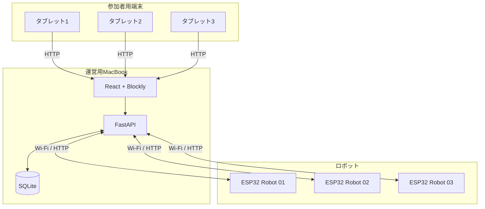
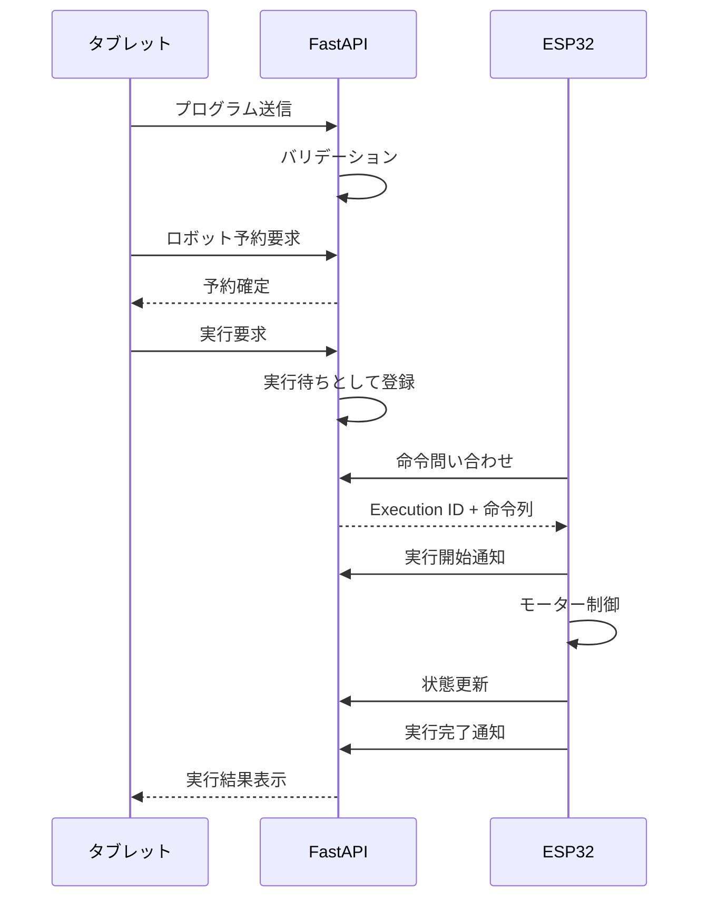

# 子ども向けロボットプログラミング教室
# アプリケーション・システム設計仕様書

**バージョン：** 1.0  
**作成日：** 2026年11月14日  
**用途：** Codexへの開発引き継ぎ  
**開発段階：** ハードウェア試作・基本走行試験完了、アプリケーション開発開始前

---

# 1. プロジェクト概要

## 1.1 目的

小中学生向けに、自分で考えたプログラムによって物理的なロボットカーを動かすプログラミング教室を開発する。

子どもたちが以下のサイクルを体験できるようにする。

1. 紙のマップやコマンドカードを使ってプログラムを考える。
2. タブレットのブロック型エディタに命令を入力する。
3. 空いているロボットを選択する。
4. プログラムを送信し、実機で実行する。
5. 結果を観察する。
6. 失敗した原因を考える。
7. プログラムを修正して再挑戦する。

**重視するのは、試行錯誤による問題解決、論理的思考、達成感である。**

単純な総当たりや、何度も無計画に実行するだけで攻略できる構造は避けたい。

子ども同士の競争よりも、自分自身の改善や課題達成を重視する。

## 1.2 対象

- 小学生・中学生
- 参加者約10名を想定
- 学習経験や理解度には個人差がある
- 発達特性などに応じた操作・説明上の配慮が必要
- プログラミング未経験者を含む

## 1.3 開催概要

- 開催時間：約3時間30分
- 会場：地域の公共施設
- ロボット：当日3台程度を想定
- 子ども用端末：タブレットを共用
- ネットワーク：持ち込みWi-Fiルーター
- 運営用PC：MacBook

## 1.4 教室運営の基本方針

**「机上で計画 → 実行ステーションで検証」方式を正式採用する。**

子どもは自席で紙を使って考え、ロボットを動かすときだけ実行ステーションへ移動する。

プログラム作成・実行の全工程を各自の端末で自由に繰り返す方式にはしない。

ロボットの実行時には、子ども自身が空いているロボットを選択する。

---

# 2. 開発範囲

## 2.1 今回実装するもの

### 必須

- ESP32によるWi-Fi通信
- ESP32のモーター制御
- JSON形式のプログラム受信
- 複数命令の順次実行
- 前進・後退・左右旋回
- 指定マス数の移動
- 90度旋回の時間制御
- ブロック型プログラミングUI
- 繰り返し処理
- 日本語・子ども向けのやさしい表示
- プログラムの検証
- 空きロボットの一覧表示
- ロボット選択
- ロボットの予約
- ロボットごとの実行管理
- 実行中の排他制御
- 実行状態の表示
- 停止命令
- 通信異常時の安全停止
- ロボットごとのキャリブレーション
- 運営者向けの基本管理機能

### 可能なら実装

- プログラムの保存・再編集
- 実行履歴
- エラーの詳細表示
- ロボットの接続状態監視
- ロボット設定の管理画面
- 実行結果の記録

## 2.2 今回実装しないもの

- シミュレーター
- Blockly Games自体の改造
- 特定のゲーム世界観
- レストランや倉庫番などのゲームルール
- カラーセンサー
- ライントレース
- エンコーダーによる位置制御
- カメラによる位置推定
- 自動経路探索
- 高精度な自己位置推定
- クラウドへの本番デプロイ
- ユーザーごとの本格的なアカウント認証
- オンラインランキング
- Bluetooth通信

将来実装する可能性があるものは、拡張余地を残す。

ただし、拡張性を理由に初期実装を過度に複雑化しないこと。

---

# 3. ハードウェア仕様

## 3.1 使用するロボット

タミヤの工作部品とESP32を使った自作2輪駆動ロボットカー。

| 項目 | 仕様 |
|---|---|
| マイコン | Freenove ESP32-WROOM開発ボード |
| モータードライバ | SSCI-093415 DRV8835 |
| ギヤボックス | タミヤ70097 |
| モーター | FA-130 ×2 |
| タイヤ | タミヤ70111 スポーツタイヤ |
| タイヤ直径 | 56mm |
| 補助輪 | タミヤ70144 ボールキャスター |
| シャーシ | タミヤ系ユニバーサルプレート |
| 駆動方式 | 左右独立2輪駆動 |
| ギヤ比 | 203.7:1 |
| センサー | なし |
| エンコーダー | なし |

## 3.2 電源

電源は2系統。

### ESP32

- USB 5V
- モバイルバッテリーから給電
- 開発時はPCのUSBから給電可能

### モーター

- 単3アルカリ乾電池2本
- 公称約3V
- 電源スイッチ経由でDRV8835へ給電
- 降圧モジュールは使用しない

ESP32とDRV8835はGNDを共通にする。

ただし、モーター電流の大きい経路をブレッドボードに通さない。

## 3.3 ESP32とDRV8835のピン対応

SSCI-093415の端子表記に合わせる。

| ESP32 | DRV8835 | 用途 |
|---|---|---|
| GPIO25 | AI1 | 左モーター入力1 |
| GPIO26 | AI2 | 左モーター入力2 |
| GPIO27 | BI1 | 右モーター入力1 |
| GPIO14 | BI2 | 右モーター入力2 |
| 3V3 | VCC | ロジック用電源 |
| GND | GND | 共通GND |
| GND | MD | IN/INモード設定 |

モーター電源：

- 電池＋ → スイッチ → VM
- 電池－ → GND

モーター出力：

- AO1/AO2 → 左モーター
- BO1/BO2 → 右モーター

DRV8835にはGNDピンが2本、VMピンが2本存在する。

同名の2端子は基板内部で接続されている。

一方のGNDをモーター電源の帰還経路に、もう一方をESP32との信号GND接続に利用する構成を想定している。

**注意：SSCI-093415には電源逆接続保護がない。**

## 3.4 モーター制御

DRV8835はIN/INモードを使用する。

1チャンネルの基本動作：

| IN1 | IN2 | 動作 |
|---|---|---|
| LOW | LOW | 空転停止 |
| HIGH | LOW | 一方向に回転 |
| LOW | HIGH | 逆方向に回転 |
| HIGH | HIGH | ブレーキ |

実際の車輪の前進方向は、配線・モーター取り付け方向に依存する。

そのため、左右モーターごとに反転設定を保持する。

## 3.5 走行試験の状況

**確認済み：**

- ESP32へのPlatformIOからの書き込み
- DRV8835を介した左右モーター制御
- 前進
- 後退
- 左旋回
- 右旋回
- 実機での走行

現在の走行試験コードでは、次の値を基準としている。

```cpp
constexpr uint8_t AI1 = 25;
constexpr uint8_t AI2 = 26;
constexpr uint8_t BI1 = 27;
constexpr uint8_t BI2 = 14;

constexpr bool INVERT_LEFT = false;
constexpr bool INVERT_RIGHT = true;

constexpr unsigned long MOVE_TIME_MS = 500;
constexpr unsigned long TURN_LEFT_MS = 330;
constexpr unsigned long TURN_RIGHT_MS = 330;
```

ただし、実際の走行確認でF/BとL/Rの方向指定を反転している。

そのため、新しいファームウェアではモーター方向の補正を一元化すること。

**上記の反転設定と旋回時間は試作機の暫定値であり、確定キャリブレーションではない。**

以前のコードに含まれていた命令と反転処理を二重に適用しないよう注意すること。

## 3.6 走行制御の制約

今回のロボットには位置センサーがない。

したがって、

- 1マス移動は時間制御
- 90度旋回も時間制御
- 実際の位置や角度を計測できない
- 走行距離は電池電圧や床面に影響される
- 実機がゴールに到着したことを自動判定できない

これを前提としてアプリケーションを設計する。

「命令を実行完了した」ことと「物理的に正しい位置に到着した」ことは区別する。

---

# 4. 全体アーキテクチャ

## 4.1 採用方針

**ローカルWi-Fi・中央サーバー方式を採用する。**

各ESP32が独立して動作し、MacBook上のサーバーを通じてプログラムを受け取る。

ロボット同士は直接通信しない。



すべての端末を同じL12のLANへ接続する。

## 4.2 技術スタック

| 領域 | 技術 |
|---|---|
| フロントエンド | React |
| 言語 | TypeScript |
| ビルド | Vite |
| スタイリング | Tailwind CSS |
| ブロックエディタ | Google Blockly |
| APIサーバー | Python / FastAPI |
| DB | SQLite |
| ESP32 | PlatformIO |
| ESP32 Framework | Arduino |
| 無線 | Wi-Fi |
| プロトコル | HTTP / JSON |
| サーバー | 運営用MacBook |
| ルーター | Speed Wi-Fi HOME 5G L12 |
| クラウド | 初期段階では使用しない |

## 4.3 Bluetoothを採用しない理由

Bluetooth Low Energyも検討したが、今回は採用しない。

理由：

- ブラウザからBLEへアクセスする場合、OS・ブラウザによる制約がある
- iPadなどでWeb Bluetoothが使えない場合がある
- 3台同時の中央管理が複雑になる
- 接続・再接続処理が増える
- HTTP APIを利用する構成の方が開発しやすい
- MacBook上のサーバーで実行履歴・予約管理を統合しやすい

Wi-Fiであれば、端末を問わず一般的なブラウザから操作しやすい。

## 4.4 L12について

既存のSpeed Wi-Fi HOME 5G L12を使用する。

開催会場にはフリーWi-Fiがない。

インターネット接続自体は必須としない。

MacBookとESP32、タブレットの通信はLAN内で完結させる。

### 検証予定

- 自宅
- 大学研究室

それぞれの環境でL12を使用して、ローカル通信が成立するか確認する。

確認事項：

- MacBookからWebアプリを配信できる
- 他端末のブラウザからアクセスできる
- ESP32がL12へ接続できる
- ESP32とFastAPIが通信できる
- 複数端末から同時アクセスできる
- WiMAXのインターネット回線に依存しない
- L12再起動後に再接続できる
- macOSのスリープによる切断を防げる

## 4.5 MacBookでのデプロイ

開発時：

- React：Vite開発サーバー
- FastAPI：開発サーバー

イベント当日：

- Reactをビルドする
- FastAPIから静的ファイルを配信する
- FastAPIのAPIも同一オリジンで提供する
- SQLiteをローカルに保存する

例：

```text
http://192.168.179.10:8000/
http://192.168.179.10:8000/api/robots
```

IPアドレスは例。

MacBookのLAN内アドレスでアクセスする。

`127.0.0.1`のみの待ち受けでは他端末から接続できないため、サーバーはLANからアクセス可能なアドレスにバインドする。

イベント当日は、MacBookがスリープしないよう設定する。

**注意：HTTPを利用するローカル環境では、認証キーやプログラム内容が暗号化されない。ネットワークへの参加者を制限し、機密性の高い情報は扱わない。**

将来、外部ネットワークへ公開する場合はHTTPSや認証方式を再検討する。

---

# 5. ロボット3台の管理

## 5.1 基本方針

ESP32のファームウェアは3台とも共通とする。

ロボットごとに異なるソースコードを管理しない。

以下を個体別設定として管理する。

- Robot ID
- 認証情報
- Wi-Fi設定
- サーバー接続先
- モーター反転設定
- 前進・後退の時間
- 左右旋回の時間
- 必要に応じてPWM設定

例：

```json
{
  "robotId": "robot-01",
  "calibration": {
    "invertLeft": false,
    "invertRight": true,
    "moveOneCellMs": 1100,
    "turnLeft90Ms": 330,
    "turnRight90Ms": 330
  }
}
```

値は例であり、機体ごとに実測する。

## 5.2 ロボットID

初期段階では次の3台を扱う。

| ID | 表示名 |
|---|---|
| robot-01 | ロボットA |
| robot-02 | ロボットB |
| robot-03 | ロボットC |

将来的に台数が増えても動作するよう、台数をコードにハードコードしない。

## 5.3 プログラムの配信先

子どもがBlocklyで作ったプログラムを、選択したロボットに対して実行する。

重要なのは、**ESP32へ子どもが作ったプログラムをファームウェアとして書き込まないこと**。

ESP32には共通の実行エンジンをPlatformIOから事前に書き込む。

子どもの命令列はJSONデータとして送信する。

---

# 6. 通信設計

## 6.1 基本方式

**ESP32起点のHTTP通信を第一候補とする。**

ESP32がFastAPIへ定期的に問い合わせる。

中央サーバーは、各ロボットに実行すべきプログラムを割り当てる。

ロボットのIPアドレス固定を必須にしない。

初期設計：

- ESP32 → FastAPI
- HTTP
- JSON
- 定期ポーリング
- 数百ms程度のポーリング間隔

実行中も停止指示・通信状態を確認できるようにする。

## 6.2 通信フロー



これは論理フロー。

実装時には実行要求の原子性・再試行・通信断処理を詳細化する。

## 6.3 ポーリングと停止処理

HTTPポーリングだけで停止を実現する場合、ポーリング間隔に応じて停止遅延が発生する。

安全性を考慮して次を満たすこと。

- モーター制御は非ブロッキング
- 実行中でも通信処理が継続できる
- STOP要求を優先できる
- 実行許可の期限を監視する
- 通信途絶時には停止する
- 停止後に勝手に実行を再開しない

サーバーからの停止命令と、ESP32内部のタイムアウトを併用する。

**物理的なモーター電源スイッチは必ず残す。**

---

# 7. アプリケーションUI

## 7.1 基本方針

**Google Blocklyをブロックエディタとして利用する。**

Blockly Gamesは採用しない。

Blockly Gamesのゲームを改造するのではなく、Google BlocklyライブラリをReactへ組み込む。

Reactがアプリ全体を管理し、Blocklyはブロック編集領域を担当する。

## 7.2 Blocklyを選ぶ理由

- 独自ブロックを定義できる
- ブロック同士を接続できる
- ネストを表現できる
- 繰り返し処理に対応できる
- 日本語化できる
- 子ども向けのやさしい文言を設定できる
- ブロックの色を変更できる
- ブロックの形状を変更できる
- ツールボックスの内容を変更できる
- 初級・応用で利用可能な命令を制限できる
- 編集状態を保存・復元できる

## 7.3 子ども向け表示

一般的なプログラミング用語をそのまま見せない。

| 内部的な意味 | 表示文言 |
|---|---|
| MOVE_FORWARD | まえに ○マス すすむ |
| MOVE_BACKWARD | うしろに ○マス すすむ |
| TURN_LEFT | ひだりを むく |
| TURN_RIGHT | みぎを むく |
| REPEAT | ○かい くりかえす |
| WAIT | ○びょう まつ |
| EXECUTE | ロボットを うごかす |
| STOP | とめる |

表記は今後調整できるようにする。

内部の命令IDは表示文言に依存させない。

## 7.4 Blocklyの見た目

初期候補としてZelosレンダラーを検討する。

Scratchに近い丸みのあるブロック形状を目指す。

UIデザイン方針：

- 日本語
- ひらがな中心
- 大きな文字
- 大きなタッチ領域
- 明確なコントラスト
- 直感的なアイコン
- 命令の種類ごとに一貫した配色
- 不必要な設定項目は表示しない
- タブレットで操作しやすい
- 誤操作から復帰しやすい

Blockly内部の編集UIと、React側の画面を分離する。

## 7.5 難易度別の機能

### 初級

- 前進
- 後退
- 左旋回
- 右旋回

### 応用

- 回数付きの移動
- 繰り返し
- 待機

初級・応用の分類は仮のもの。

課題に応じてBlocklyのツールボックスを変更できる構造とする。

## 7.6 Blocklyの独自ブロック

例えば前進ブロック：

```typescript
Blockly.defineBlocksWithJsonArray([
  {
    type: "robot_move_forward",
    message0: "まえに %1 マス すすむ",
    args0: [
      {
        type: "field_number",
        name: "STEPS",
        value: 1,
        min: 1,
        max: 10,
        precision: 1
      }
    ],
    previousStatement: null,
    nextStatement: null,
    colour: 210
  }
]);
```

数値範囲や色は最終確定ではない。

ロボット制御に必要な最小限のブロックから実装する。

---

# 8. プログラムのデータ構造

## 8.1 設計方針

プログラムには3つの表現を設ける。

1. Blockly Workspaceデータ
2. 独自AST
3. ESP32向け実行命令列

**Blocklyの保存JSONを、そのままESP32に送信しない。**

## 8.2 Blockly Workspace

Blocklyの標準的な保存・復元機能を使用する。

編集途中のブロック配置、入力値、接続関係を保存する。

React側でBlocklyのライフサイクルを管理する。

## 8.3 AST

プログラムの意味を表現する内部構造。

基本例：

```json
{
  "version": 1,
  "commands": [
    {
      "type": "MOVE",
      "direction": "FORWARD",
      "steps": 3
    },
    {
      "type": "TURN",
      "direction": "RIGHT"
    }
  ]
}
```

繰り返しを含む例：

```json
{
  "version": 1,
  "commands": [
    {
      "type": "REPEAT",
      "count": 3,
      "body": [
        {
          "type": "MOVE",
          "direction": "FORWARD",
          "steps": 2
        },
        {
          "type": "TURN",
          "direction": "RIGHT"
        }
      ]
    }
  ]
}
```

## 8.4 ASTの検証

必須のバリデーション：

- 正しい命令タイプか
- 必須フィールドが存在するか
- 数値が整数であるか
- 移動マス数が許容範囲内か
- 繰り返し回数が許容範囲内か
- ネストが深すぎないか
- 展開後の命令数が上限以内か
- 総実行時間が上限以内か
- 未接続のブロックがないか
- 未対応のブロックを使用していないか

サーバー側で必ず検証する。

クライアント側のチェックだけを信用しない。

## 8.5 命令列への変換

繰り返しブロックはサーバー側で展開する。

例：

```text
3かい くりかえす
    2マスすすむ
    みぎをむく
```

変換後：

```json
{
  "version": 1,
  "commands": [
    {"type": "MOVE", "direction": "FORWARD", "steps": 2},
    {"type": "TURN", "direction": "RIGHT"},
    {"type": "MOVE", "direction": "FORWARD", "steps": 2},
    {"type": "TURN", "direction": "RIGHT"},
    {"type": "MOVE", "direction": "FORWARD", "steps": 2},
    {"type": "TURN", "direction": "RIGHT"}
  ]
}
```

ESP32側では基本命令のみ解釈する。

将来、センサー条件分岐を追加する場合は、実行時評価が必要になるため別途設計する。

---

# 9. ロボット選択・実行ステーション

## 9.1 正式採用する運用

**案B：紙で計画してから、タブレットで入力し、空いているロボットを指定する方式。**

子どもは次の手順で操作する。

1. 自席でプログラムを考える。
2. 実行ステーションへ移動する。
3. Blocklyで命令を入力する。
4. プログラムを確認する。
5. 空きロボットを選択する。
6. そのロボットを予約する。
7. プログラムを送信する。
8. ロボットが実行する。
9. 実行結果を観察する。
10. 自席で改善する。

## 9.2 ロボット選択UI

表示例：

```text
どのロボットに送りますか？

○ ロボット A   空き
○ ロボット B   実行中
○ ロボット C   空き

[ロボットを選ぶ]

[プログラムを送る]
```

実行中やオフラインのロボットは選べない。

選択可能なロボットはサーバーの状態に基づいて決定する。

## 9.3 ロボット状態

次の状態を想定する。

| 状態 | 内容 |
|---|---|
| OFFLINE | 接続なし |
| IDLE | 待機中 |
| RESERVED | 予約済み |
| READY | プログラム実行準備完了 |
| RUNNING | 実行中 |
| COMPLETED | 実行完了 |
| STOPPED | 停止 |
| ERROR | 異常 |

状態遷移はサーバーを正とする。

ESP32から受信した実行状態と整合させる。

## 9.4 排他制御

必須要件：

- 同じロボットを2人が同時に予約できない
- 実行中のロボットへ新しい命令を送れない
- 同じプログラムを誤って二重実行しない
- 予約済みのロボットを他の参加者が使えない
- 予約が放置された場合は解放される
- 実行中のロボットは予約期限で解放されない
- 通信断で実行状態が不明なロボットを再割り当てしない

SQLiteのトランザクションを利用する。

予約の取得は、読み取りと更新を別々の無保護な処理にしない。

## 9.5 予約期限

初期候補：

- 予約有効期限：30〜60秒程度

最終値は運営を検証して決定する。

予約を延長する必要がある場合は明示的に扱う。

実行開始後は予約期限ではなく実行状態で管理する。

---

# 10. 実行管理

## 10.1 識別子

以下の識別子を明確に分離する。

| 識別子 | 役割 |
|---|---|
| Robot ID | ロボット個体の識別 |
| Program ID | 保存プログラムの識別 |
| Reservation ID | ロボット利用権の識別 |
| Execution ID | プログラム実行の識別 |
| Session ID | 操作セッションの識別 |

## 10.2 Execution

例：

```json
{
  "executionId": "run-000123",
  "robotId": "robot-02",
  "programId": "program-456",
  "reservationId": "reserve-001",
  "status": "RUNNING"
}
```

## 10.3 二重実行防止

ESP32が同じExecution IDを複数回受け取っても、同じプログラムを勝手に再実行してはいけない。

通信再試行により、次の問題が起きないようにする。

- 同じ命令が2回実行される
- 通信復旧後に前回の命令が再実行される
- 停止済みプログラムが再開する
- 古い命令が新しい実行に混入する

実行IDを利用して冪等性を設計する。

ESP32が実行済みIDを保持する方法、再起動時の扱いは詳細設計で定義する。

## 10.4 状態報告

ESP32からサーバーへ以下を報告する。

- Robot ID
- Execution ID
- 状態
- 現在の命令位置
- 実行開始
- 実行完了
- 停止
- エラー

例：

```json
{
  "robotId": "robot-01",
  "executionId": "run-000123",
  "status": "RUNNING",
  "currentCommandIndex": 2
}
```

---

# 11. ESP32ファームウェア設計

## 11.1 基本構成

ファームウェアは以下の機能に分割する。

- Wi-Fi接続
- HTTP通信
- ロボット認証
- 命令取得
- JSON解析
- 命令実行
- モーター制御
- 実行時間管理
- 停止処理
- キャリブレーション
- 状態報告

## 11.2 モーター制御

モーター制御は、以下の基本命令を提供する。

```cpp
void stopMotors();

void setLeftMotor(int direction);

void setRightMotor(int direction);

void startMotion(
    int leftDirection,
    int rightDirection,
    unsigned long duration
);
```

実装時には、GPIOの反転処理を一元化する。

アプリケーションレイヤーが、実機配線に依存するLOW/HIGHの詳細を知る必要はない。

## 11.3 非ブロッキング実行

長時間の`delay()`に依存しない。

`millis()`等で時間を管理する。

モーター動作中にも以下を継続する。

- STOP要求の確認
- 通信処理
- タイムアウト確認
- 実行状態更新

## 11.4 安全性

- 起動時はモーター停止
- 実行待機中はモーター停止
- 命令ごとに最大実行時間を設定
- 実行全体にも最大時間を設定
- 通信異常時は停止
- 通信復帰だけでは自動再開しない
- 不正な命令は拒否
- 異常な状態遷移は拒否
- ハードウェアの物理電源スイッチを利用できる状態にする

今回のDRV8835とFA-130では、モーター拘束時にドライバの許容電流を超える可能性がある。

電流センサーは搭載しないため、ソフトウェアで拘束状態を確実に検出できると仮定しない。

## 11.5 通信異常時の停止

実行中にサーバーと通信が途絶えた場合、安全側へ停止させる。

具体的な方法は、実行許可の有効期限・Heartbeat・Watchdog等の組み合わせで設計する。

ただし、単純なHTTPポーリングでは停止に遅延が生じる。

停止遅延の上限を設計・測定すること。

---

# 12. API設計案

以下は推奨する論理APIであり、最終的なパスは実装時に調整可能。

## 12.1 クライアント向け

```http
GET /api/robots
```

ロボット一覧・状態取得。

```http
POST /api/programs
```

プログラム保存。

```http
POST /api/robots/{robotId}/reservations
```

ロボット予約。

```http
DELETE /api/reservations/{reservationId}
```

予約解放。

```http
POST /api/executions
```

プログラム実行要求。

```http
GET /api/executions/{executionId}
```

実行状態取得。

```http
POST /api/executions/{executionId}/stop
```

停止要求。

## 12.2 ESP32向け

```http
POST /api/robot-agent/register
```

ロボット登録・接続。

```http
GET /api/robot-agent/commands
```

実行命令取得。

ロボットは認証情報により識別する。

```http
POST /api/robot-agent/executions/{executionId}/status
```

実行状態報告。

```http
POST /api/robot-agent/heartbeat
```

接続状態報告・実行許可更新。

## 12.3 API設計時に必須の検討

- 認証
- 入力バリデーション
- 実行IDの一意性
- 重複送信
- トランザクション
- タイムアウト
- ロボット再起動
- サーバー再起動
- 予約の期限切れ
- 状態不整合の解消
- 停止命令の優先順位
- HTTP再試行

---

# 13. データベース設計案

SQLiteを使用する。

最低限、以下のエンティティを設ける。

## 13.1 Robots

ロボットの個体情報。

- id
- display_name
- status
- last_seen_at
- firmware_version
- calibration
- enabled

認証キーは適切に保護して管理する。

## 13.2 Programs

子どもが作成したプログラム。

- id
- session_id
- name
- blockly_workspace
- ast
- created_at
- updated_at

## 13.3 Reservations

ロボットの予約。

- id
- robot_id
- session_id
- status
- created_at
- expires_at

## 13.4 Executions

プログラム実行。

- id
- robot_id
- program_id
- reservation_id
- status
- execution_payload
- started_at
- completed_at
- error_code

## 13.5 Robot Events

ロボットの状態変更履歴。

- id
- robot_id
- execution_id
- event_type
- payload
- created_at

イベントログは、不具合の原因調査に使用する。

---

# 14. セキュリティ

ローカルLAN上でも認証・アクセス制御を行う。

## 14.1 ロボットの認証

ロボットIDだけでアクセスを許可しない。

ロボットごとの認証情報を持たせる。

ESP32の認証キーはソースコードへ直接コミットしない。

## 14.2 利用者の権限

初期案：

| 権限 | 操作 |
|---|---|
| 子ども | プログラム編集・保存・実行申請 |
| 実行ステーション | ロボット選択・予約 |
| スタッフ | 実行停止・状態確認 |
| 管理者 | ロボット設定・キャリブレーション |

初回は本格的な個人アカウントを作らなくてもよい。

ただし、子ども用端末から管理機能にアクセスできないようにする。

## 14.3 通信

- インターネットへの公開はしない
- L12のWi-Fi認証を利用する
- 端末間通信を許可する必要がある
- 管理画面は認証を設ける
- API側でも権限を検証する

HTTPの盗聴耐性には限界があるため、セキュリティ上の前提を明確にする。

---

# 15. 運営設計

## 15.1 当日の構成

- ロボット3台程度
- 参加者約10名
- 複数の実行ステーション
- タブレットを共用
- MacBookを運営用サーバーとして使用

## 15.2 操作の流れ

```text
紙でプログラムを考える
         ↓
実行ステーションへ移動
         ↓
Blocklyで命令を入力
         ↓
プログラムを確認
         ↓
空きロボットを選択
         ↓
ロボットを予約
         ↓
プログラムを実行
         ↓
実機の動作を観察
         ↓
机上へ戻って改善
```

## 15.3 総当たり対策

教育目的上、思いつくままに何度も実行するだけで課題を攻略できる設計にはしない。

採用したい方法：

- 紙カードによる事前計画
- 実行ステーションの共有
- 実行回数の記録
- プログラムの改善内容の振り返り
- 実行前の確認
- 自己ベストの更新

ただし、失敗を過度に罰しない。

試行錯誤の自由は残す。

---

# 16. UI設計上の原則

## 16.1 子ども向けUI

- 少ない操作で使用できる
- 表示する情報を絞る
- 日本語・ひらがな中心
- 大きなブロック
- 大きなボタン
- 分かりやすい状態表示
- エラー時に次の行動が分かる
- タブレットで操作可能
- 画面から離れてもデータが消えにくい

## 16.2 実行前の確認

子どもが実行する前に、次の内容を示す。

- 命令の概要
- 命令数
- 選択したロボット
- 実行可能な状態か
- 実行するかどうか

誤ったロボットへプログラムを送信しないようにする。

## 16.3 エラー表示

技術的なメッセージをそのまま表示しない。

例：

| 内部エラー | 子ども向け表示 |
|---|---|
| ROBOT_OFFLINE | ロボットと つながっていません |
| ROBOT_BUSY | このロボットは いま つかっています |
| INVALID_PROGRAM | めいれいを かくにんしてね |
| EXECUTION_TIMEOUT | じかんが かかったので とまりました |
| RESERVATION_EXPIRED | もういちど ロボットを えらんでね |

スタッフ向けには詳細なエラーコードとログを表示する。

---

# 17. 開発リポジトリ構成案

```text
robot-workshop/
├── apps/
│   ├── web/
│   │   ├── src/
│   │   │   ├── components/
│   │   │   ├── features/
│   │   │   │   ├── blockly/
│   │   │   │   ├── programs/
│   │   │   │   ├── robots/
│   │   │   │   ├── executions/
│   │   │   │   └── admin/
│   │   │   ├── pages/
│   │   │   ├── api/
│   │   │   └── styles/
│   │   ├── package.json
│   │   └── vite.config.ts
│   │
│   └── server/
│       ├── app/
│       │   ├── api/
│       │   ├── models/
│       │   ├── schemas/
│       │   ├── services/
│       │   ├── robots/
│       │   ├── executions/
│       │   └── database/
│       └── pyproject.toml
│
├── firmware/
│   ├── src/
│   │   ├── main.cpp
│   │   ├── motor_control.cpp
│   │   ├── wifi_client.cpp
│   │   ├── command_executor.cpp
│   │   └── robot_state.cpp
│   ├── include/
│   └── platformio.ini
│
├── shared/
│   └── schemas/
│
├── docs/
│   ├── architecture.md
│   ├── api.md
│   ├── protocol.md
│   ├── hardware.md
│   └── operation.md
│
└── README.md
```

これは推奨するディレクトリ構造。

既存のリポジトリがある場合は、その構成と整合させる。

---

# 18. 開発フェーズ

## Phase 1：Wi-Fi通信基盤

- ESP32をL12へ接続
- MacBookでFastAPIを起動
- ESP32からFastAPIへHTTP通信
- Robot IDによる識別
- 接続状態の取得
- 通信断からの復帰

**完了条件：** ESP32がUSBシリアル通信を使わず、Wi-Fiを通じてサーバーと通信できる。

## Phase 2：ESP32実行エンジン

- JSON受信
- MOVE
- TURN
- 時間制御
- 個体別キャリブレーション
- 実行状態管理
- 自動停止
- STOP命令

**完了条件：** HTTPで受信した複数命令を順番に実行できる。

## Phase 3：バックエンド

- Robot管理
- Program管理
- Execution管理
- Reservation管理
- SQLite
- 排他制御
- 重複実行防止
- エラー管理

**完了条件：** ロボットの予約から実行完了まで一貫して管理できる。

## Phase 4：Blockly UI

- Reactアプリ
- Blockly導入
- 独自ブロック
- 日本語表示
- REPEAT
- AST変換
- プログラム検証
- ロボット選択
- 実行ボタン
- エラー表示

**完了条件：** 子ども向けUIから作成したプログラムを実機で実行できる。

## Phase 5：3台運用

- 3台の登録
- 個体別設定
- ロボット選択
- 予約競合
- 同時実行
- 通信断処理
- サーバー再起動時の復旧
- 管理画面

**完了条件：** 3台に異なるプログラムを割り当て、独立して実行できる。

## Phase 6：教育用コンテンツ

技術基盤の完成後に検討する。

- 課題
- マップ
- 難易度
- 世界観
- スコア
- 振り返り
- 教材

---

# 19. テスト方針

## 19.1 ファームウェア

- 起動直後にモーターが回らない
- MOVEが正しく実行される
- TURNが正しく実行される
- 指定時間で停止する
- STOPで停止する
- 通信断で停止する
- 不正な命令を拒否する
- 重複Execution IDを再実行しない
- 再起動後に勝手に旧命令を実行しない

## 19.2 バックエンド

- 複数のプログラムを保存できる
- ロボット予約が重複しない
- 予約期限切れを扱える
- 実行中はロボットを再割り当てしない
- 同じExecution IDを二重実行しない
- 状態遷移が正しい
- ロボット切断を検出できる
- サーバー再起動後に状態を復元・整合できる

## 19.3 UI

- ブロックを追加できる
- ブロックを削除できる
- ブロックを並べ替えられる
- 繰り返しを組み立てられる
- プログラムを保存できる
- 不正なプログラムを検出できる
- 空きロボットを選択できる
- 実行中のロボットを選べない
- タブレットで操作できる
- エラーを理解できる

## 19.4 ネットワーク

- 自宅L12環境
- 研究室L12環境
- 複数端末アクセス
- インターネット切断時
- L12再起動時
- ESP32再起動時
- MacBookスリープ復帰時
- 複数ESP32同時通信

---

# 20. 未確定事項

以下は今後の実装・検証を通じて決定する。

| 項目 | 現在の方針 |
|---|---|
| プロジェクト名 | 未定 |
| リポジトリ名 | 未定 |
| タブレット台数 | 未定 |
| ロボットの最終台数 | 3台程度 |
| Blocklyの具体的なテーマ | 未定 |
| ブロックの色 | 未定 |
| ブロックの細かな文言 | 未定 |
| Blocklyの最大ネスト深度 | 未定 |
| 最大命令数 | 要設計 |
| 最大実行時間 | 要設計 |
| ポーリング間隔 | 数百msを候補 |
| 通信断のタイムアウト | 要設計 |
| 予約有効期限 | 30〜60秒を候補 |
| 認証方式 | 要詳細設計 |
| Wi-Fi設定の投入方法 | 要設計 |
| 個体別設定の保存先 | 要設計 |
| 実行結果の評価方法 | 未定 |
| ゲームテーマ | 後から決定 |
| マップ仕様 | 後から決定 |
| スコア方式 | 後から決定 |

---

# 21. Codexへの実装指示

この仕様書を基に実装を進めること。

## 基本方針

1. **まずコードベースと環境を確認する。**
2. 既存のESP32走行試験コードを可能な限り活用する。
3. いきなり全機能を実装せず、段階的に進める。
4. まずWi-Fi経由で1台を制御できる状態にする。
5. その後、JSON実行エンジンを実装する。
6. 実行管理・予約管理を実装する。
7. Blocklyを導入する。
8. 最後に3台運用を検証する。

## 技術的な優先事項

- 型安全性
- 責務分離
- 状態管理の整合性
- 排他制御
- 通信再試行
- 冪等性
- 異常時の安全停止
- 検証可能な設計
- 複数台への拡張性
- 運営時の使いやすさ

## 特に注意すること

**ロボットが物理的に動くため、単なるWebアプリ以上に安全性を優先する。**

通信障害やアプリの例外によってモーターが動き続ける設計は避ける。

また、ESP32のプログラム実行が完了しても、実機が目的地へ到達したと判断しない。

Blocklyの編集状態と、実行用プログラムは分離する。

子ども向けの日本語UIは、内部のコマンド定義とは切り離して管理する。

## 実装開始時に行うこと

最初に以下を提示すること。

1. 現在のコード・環境の確認結果
2. 技術スタックの最終案
3. ディレクトリ構成
4. 通信プロトコル案
5. 実行状態遷移
6. 安全停止の設計
7. Phase 1の実装計画

その後、Phase 1から実装する。

---

# 22. 最終的な目標

**約10人の子どもが、3台の自作ESP32ロボットカーを共有しながら、紙で考えたプログラムをBlocklyで入力して実行できるシステムを完成させる。**

実機の操作はタブレットから行い、MacBookが予約・プログラム配信・実行状態を管理する。

システムはインターネット接続なしでも運用できるようにする。

教室では、ロボットを動かすこと自体よりも、考える・試す・改善する体験を重視する。

この技術基盤を使い回し、将来的にはマップや世界観を変えた複数回のプログラミング教室を開催できるようにする。